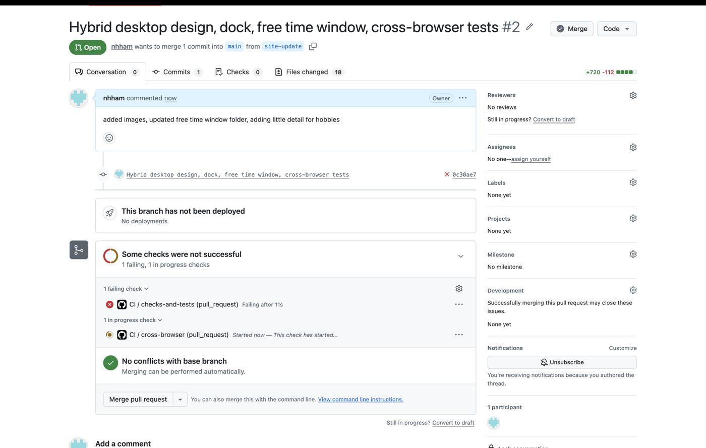
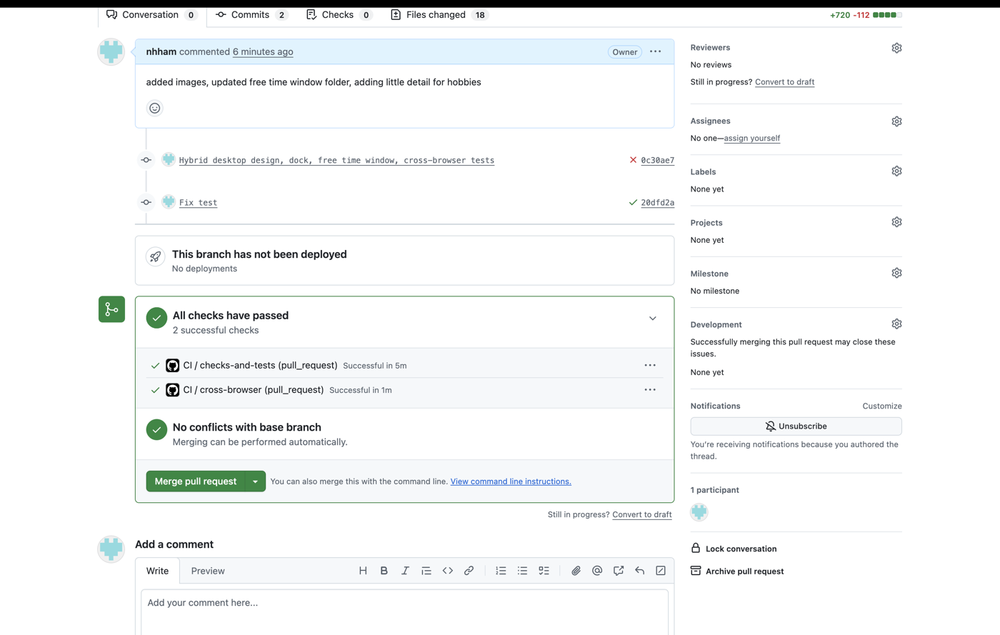
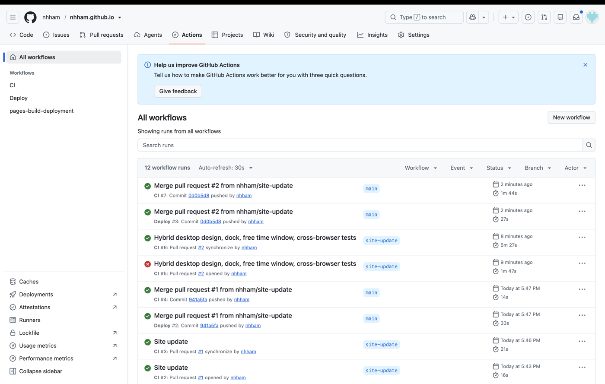

# nathaniel ham: personal site

**Live:** https://nhham.github.io

A "desktop" style personal site showing what I'm working on right now (Regulate, SAIL 2027, NOBE) plus Priors.

## Interactive feature

- **Filter:** the tabs in the top bar (all · web · data · design · markets) bring matching project windows forward and fade the rest. A tag with no projects shows an empty-folder window with a **reset** button.
- **Drag:** drag any window by its title bar. Windows can't be dragged off the desktop; they stop at the edge.
- **Window buttons:** red (or yellow) closes a window, green expands it, and clicking a window brings it to the front. Clicking any filter tab brings closed windows back.
- **Layout:** on wide screens the windows sit around the name. In a normal-size (not full screen) browser window they tile under the name instead, so it still looks like a desktop. Only phones (under 700px) stack them in one column.
- **Dock:** a small dock at the bottom opens Free Time and links to GitHub, LinkedIn, and email.

The logic lives in `src/logic.js` as pure functions (`filterProjects`, `clampPosition`, `placeWindows`), so it can be tested without a browser. `src/main.js` connects them to the page.

## Free Time window + Clash of Clans

The **free-time** folder on the desktop opens a window with my hobbies (volleyball, basketball, Clash of Clans). The Clash of Clans card shows my Town Hall, war stars, clan, how long I've played, and a **show my base** popup.

- Stats come from the official Clash of Clans API, but **the site never calls the API**. The API key is locked to whitelisted IP addresses and must stay secret, so `scripts/fetch-coc.mjs` runs on my own machine and saves only the fields the site needs to `data/coc.json`, which is committed. The page reads that file.
- To refresh the stats:
  1. Create `.env` in the repo root (it's in `.gitignore`, never commit it):
     ```
     COC_API_KEY=your-key-from-developer.clashofclans.com
     COC_PLAYER_TAG="#YOURTAG"
     ```
     The tag needs quotes because `.env` files treat `#` as a comment.
  2. Run `npm run coc`, then commit the updated `data/coc.json`.
- `START_YEAR` and `BASE_LINK` are set at the top of `src/coc-view.js`. The base screenshot is `assets/base.jpg`.
- Logic is in `src/coc.js` (`yearsPlaying`, `playingLabel`, `clanLabel`, `isValidBaseLink`) and tested in `tests/coc.test.js`, including edge cases like a future start year, not being in a clan, and an unfilled base link.

## Setup

Requires Node 20+.

```bash
git clone https://github.com/nhham/nhham.github.io.git
cd nhham.github.io
npm install
```

To view locally, serve the folder with any static server, e.g. `npx serve .` or `python3 -m http.server`, and open the printed URL. (Opening `index.html` directly won't work because the page uses JavaScript modules.)

## Tests and checks

```bash
npm run check   # every JS file parses, every linked file exists, page has title + viewport tag
npm test        # Vitest unit tests (tests/*.test.js)
npm run e2e     # browser tests (run `npm run build` first)
npm run build   # copies the site into dist/
```

Tests cover normal use and edge cases:
- filtering by a tag, "all"/reset, an unused tag (empty state), a missing tag, and that the original list isn't modified
- dragging inside the desktop, past the top/left edge, past the bottom/right edge, and a window wider than the desktop
- window layout: phones stack; wide screens never cover the name or overlap; normal-size windows tile under the name

**Cross-browser tests** (`e2e/site.e2e.js`, Playwright) load the built site in **Chrome, Firefox, and Safari's engine (WebKit)** at desktop, laptop, small-window, and phone sizes. They check that windows never cover the name or each other, there's no sideways scrolling, and that filtering, window buttons, dragging, the dock, and Free Time all work.

## CI/CD

- **`.github/workflows/ci.yml`** runs checks, tests, and build on **every pull request** and every push to `main`. A second job, `cross-browser`, runs the Playwright tests in Chrome, Firefox, and WebKit.
- **Branch protection** on `main` requires the `checks-and-tests` job to pass before a PR can merge.
- **`.github/workflows/deploy.yml`** runs on every push to `main`: it re-runs checks and tests, builds, and deploys `dist/` to **GitHub Pages**. If anything fails, nothing deploys.

To update the site: branch → commit → open a PR → checks pass → merge → it deploys automatically.

To change the projects shown, edit `src/projects.js`.

## Checkpoint evidence

The CI/CD pipeline in action on [PR #2](https://github.com/nhham/nhham.github.io/pull/2):

**1. A failing check blocks the PR.** I broke a test on purpose (`clampPosition` expected `x: 801` instead of `800`), and `checks-and-tests` failed.



**2. Fixing the test makes every check pass**, including the cross-browser tests in Chrome, Firefox, and WebKit.



**3. Merging to `main` deploys the site.** The Actions history shows the failed run (CI #5), the passing run (CI #6), then the merge and the successful Deploy to GitHub Pages (Deploy #3).



## AI use and limitations

I used Claude (Anthropic) to help scaffold this project: the page layout and styling, the drag/filter logic, the tests, and the GitHub Actions workflows. I chose the design direction and content, reviewed and ran everything, and set up the repo, branch protection, and deployment myself.

Limitations: dragging uses pointer events and is disabled on small screens; window positions reset on reload; the tests cover the logic functions, not the visual layout.
